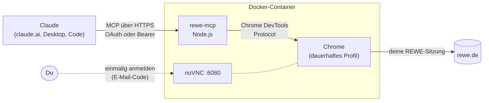

# 🛒 rewe-mcp

**Mit Claude bei REWE einkaufen.** Ein selbst gehosteter [MCP](https://modelcontextprotocol.io)-Server für den REWE Onlineshop (Abhol- und Lieferservice). Claude oder ein anderer MCP-Client sucht damit Produkte, findet das günstigste pro Kilo, füllt den Warenkorb und kauft „das Übliche“ aus deiner Bestellhistorie nach.

> „Hier ist meine Einkaufsliste. Nimm jeweils das günstigste Produkt pro kg und leg alles in den Warenkorb.“

Bestellen und bezahlen kann der Server bewusst **nicht**. Den Einkauf schließt du selbst auf rewe.de ab.

---

## Funktionen

| Tool | Was es macht |
|---|---|
| `rewe_search_products` | Produktsuche mit Preis, **Grundpreis (€/kg bzw. €/l)**, Verfügbarkeit und Angeboten (Normalpreis, Rabatt). Standardmäßig nach dem günstigsten Grundpreis sortiert, optional nur Angebote. |
| `rewe_get_product` | Details und Verfügbarkeit im gewählten Markt |
| `rewe_get_cart` | Warenkorb mit Warenwert, Pfand, Servicegebühr, Mindestbestellwert |
| `rewe_add_to_cart` | Produkt hinzufügen (Menge erhöhen) |
| `rewe_set_cart_quantity` | Menge setzen, `0` entfernt das Produkt |
| `rewe_get_order_history` | Bisherige Bestellungen (Datum, Abholung, Summe, Vorschau) |
| `rewe_get_order` | Einzelne Bestellung mit allen Artikeln, inkl. tatsächlich gelieferter Menge bzw. Gewicht |
| `rewe_get_frequent_products` | Häufig gekaufte Produkte über die letzten Bestellungen, ideal für „das Übliche“ |
| `rewe_get_pickup_slots` | Freie Abholzeitfenster (nur lesend) |
| `rewe_login_status` | Ist der Server bei REWE angemeldet? |

Alle Beträge sind in Euro (`…Eur`), alle Zeiten im ISO-Format (`2026-08-24T17:59`).

Dazu gibt es eine **Chrome-Extension**, die Produktlisten auf rewe.de direkt nach €/kg sortiert. Sie ist [unten](#chrome-extension-kilopreis-sortierung) beschrieben und für den Server nicht nötig.

---

## So funktioniert es



- **Ein echter Chrome im Container** erledigt alle Anfragen an rewe.de, mit deinem Login und deinem gewählten Markt. Es gibt keine inoffizielle App-API und kein Nachbauen von Logins.
- **Anmeldung per Fernansicht:** REWE verlangt beim Login einen E-Mail-Code und teils eine Cloudflare-Prüfung. Das erledigst du einmal selbst über noVNC im Browser. Während des Logins trennt sich der Server vom Chrome, du bedienst also einen ganz normalen Browser.
- **Sitzung wachhalten:** REWEs Shop-Token gilt nur 10 Minuten, die Login-Sitzung dahinter verfällt bei Inaktivität. Der Server lädt deshalb alle paar Minuten den Shop neu. Fehlt die Anmeldung trotzdem, versucht er zuerst eine stille Neuanmeldung über „Angemeldet bleiben“. Erst wenn das scheitert, meldet er sich mit einem Link zur Fernansicht.

---

## Schnellstart

Voraussetzungen: ein Linux-Server mit Docker und Docker Compose, etwa 1 GB RAM für Chrome und ein REWE-Konto.

```bash
git clone https://github.com/julianullrich99/rewe-mcp.git
cd rewe-mcp/server
cp .env.example .env
nano .env             # REWE_MCP_PASSWORD, REWE_VNC_PASSWORD, REWE_LOGIN_URL setzen
docker compose up -d --build
```

Der erste Build lädt das Playwright-Image mit Chrome, rund 2 GB.

### Bei REWE anmelden

1. `http://<server-ip>:6080/vnc.html` öffnen und mit dem `REWE_VNC_PASSWORD` verbinden.
2. Im ersten Tab bei REWE anmelden: Passwort, E-Mail-Code, ggf. Cloudflare-Prüfung. Den **Abholmarkt bzw. die PLZ** prüfen und „Angemeldet bleiben“ setzen, falls angeboten.
3. Im zweiten Tab auf **„Fertig – Server übernimmt“** klicken. Das Chrome-Fenster nicht schließen.

> **Tipp:** Text fügst du über die Zwischenablage in der noVNC-Seitenleiste ein. Zum Einfügen im Chrome dann `Strg+V` oder die mittlere Maustaste.

Den Status zeigt `http://<server-ip>:47823/health`, im Feld `reweSession.loggedIn`.

---

## Mit Claude verbinden

### Claude Code

```bash
claude mcp add --transport http rewe http://<server-ip>:47823/mcp --header "Authorization: Bearer <REWE_MCP_PASSWORD>"
```

### Claude Desktop

Unter Einstellungen → Entwickler → Konfiguration bearbeiten. Node.js muss installiert sein, [`mcp-remote`](https://www.npmjs.com/package/mcp-remote) übernimmt die Verbindung:

```json
{
  "mcpServers": {
    "rewe": {
      "command": "npx",
      "args": ["-y", "mcp-remote", "http://<server-ip>:47823/mcp", "--allow-http",
               "--transport", "http-only", "--header", "Authorization:${REWE_AUTH}"],
      "env": { "REWE_AUTH": "Bearer <REWE_MCP_PASSWORD>" }
    }
  }
}
```

Bei einer HTTPS-Adresse entfällt `--allow-http`.

### claude.ai (Web, App, Team)

claude.ai ruft Connectors von Anthropics Servern aus auf. Der Server muss deshalb **per HTTPS aus dem Internet erreichbar** sein, siehe [unten](#zugang-aus-dem-internet-cloudflare-tunnel). Die Anmeldung läuft über **OAuth**:

1. In `.env` die Variable `REWE_PUBLIC_URL=https://rewe.example.com` setzen und neu starten.
2. claude.ai → Einstellungen → Connectors → **Add custom connector**: nur die URL `https://rewe.example.com/mcp` eintragen.
   *Authentication: „Sign in now“*, *OAuth client: „Register automatically“*, keine Request headers.
3. Beim Verbinden öffnet sich die Seite **„REWE-Zugang freigeben“**. Dort meldest du dich mit dem `REWE_MCP_PASSWORD` an.

Weil sich **jede Person einzeln anmelden muss**, kann der Connector auch in einem Team-Workspace liegen. Ohne Passwort bekommt niemand Zugriff auf deinen Einkauf.

---

## Zugang aus dem Internet (Cloudflare Tunnel)

Am einfachsten geht es mit einem Cloudflare Tunnel. Du brauchst keine offenen Ports und keine feste IP, HTTPS ist automatisch dabei.

1. **Cloudflare Zero Trust → Networks → Tunnels → Create a tunnel** (Typ *Cloudflared*), den Token kopieren.
2. **Public hostname** hinzufügen: z.B. `rewe.example.com`, Path leer lassen, Service `HTTP` → `rewe-mcp:47823`.
3. In `.env`:
   ```bash
   COMPOSE_PROFILES=tunnel
   CLOUDFLARE_TUNNEL_TOKEN=<token>
   REWE_PUBLIC_URL=https://rewe.example.com
   ```
4. `docker compose up -d`

Über den Tunnel sind **nur** `/mcp` und die OAuth-Endpunkte erreichbar. Fernansicht, Status und Login-Hilfe bleiben im Heimnetz. Das prüft der Server selbst, auch ohne passende Pfadregel in Cloudflare.

Ein anderer Reverse-Proxy (Traefik, Caddy, nginx) funktioniert genauso. Leite dann nur `/mcp`, `/.well-known/oauth-*`, `/authorize`, `/token` und `/register` weiter.

---

## Konfiguration

| Variable | Pflicht | Beschreibung |
|---|---|---|
| `REWE_MCP_PASSWORD` | ✅ | Passwort für den Bearer-Zugang und die OAuth-Anmeldeseite (mind. 8 Zeichen, besser 32 zufällige) |
| `REWE_VNC_PASSWORD` | ✅ | Passwort der noVNC-Fernansicht (VNC nutzt nur 8 Zeichen) |
| `REWE_LOGIN_URL` | | Link zur Fernansicht, wird in Fehlermeldungen angezeigt |
| `REWE_PUBLIC_URL` | | Öffentliche HTTPS-Adresse, aktiviert OAuth |
| `COMPOSE_PROFILES=tunnel` | | Startet den Cloudflare-Tunnel-Container |
| `CLOUDFLARE_TUNNEL_TOKEN` | | Token des Cloudflare Tunnels |
| `REWE_KEEPALIVE_MIN` | | Minuten zwischen den Keepalive-Aufrufen (Standard `4`) |
| `REWE_MCP_DEBUG` | | `1` aktiviert `/debug/fetch` für Rohantworten, nur zur Entwicklung |

**Ports:** `47823` für MCP, OAuth und `/health`, `6080` für noVNC.
**Daten:** Das Docker-Volume `rewe-profile` enthält das Chrome-Profil (deine REWE-Anmeldung) und `oauth.json` mit den OAuth-Tokens, gespeichert nur als Hash.

---

## Sicherheit

- **Wer Zugriff auf den Server hat, kann in deinem Namen den Warenkorb ändern und deine Bestellhistorie samt Adresse sehen.** Wähle starke Passwörter.
- **noVNC (Port 6080) niemals ins Internet freigeben.** Dort läuft ein angemeldeter Browser, geschützt nur durch ein 8-stelliges VNC-Passwort.
- **OAuth:**
  - Codes sind nur einmal gültig und verlangen PKCE (S256).
  - Access-Tokens gelten 1 Stunde. Refresh-Tokens gelten 90 Tage und werden bei jeder Nutzung durch neue ersetzt.
  - Nach 10 falschen Passwörtern ist die Anmeldung 15 Minuten gesperrt.
- **Alle Freigaben widerrufen:** `docker compose exec rewe-mcp rm /data/oauth.json && docker compose restart rewe-mcp`. Nach einer Passwortänderung empfiehlt sich das ebenfalls.
- Der Server kann **nichts bestellen und nichts bezahlen**.

---

## Chrome-Extension: Kilopreis-Sortierung

Im Ordner [`extension/`](extension/) liegt eine Chrome-Extension für den Einkauf von Hand auf rewe.de:

- Sie sortiert Kategorie- und Suchseiten nach dem **günstigsten Preis pro kg bzw. l**. Wahlweise lädt sie dafür alle Seiten einer Liste nach oder sortiert nur die aktuelle.
- Jede Produktkachel bekommt ein Badge mit dem Grundpreis.

**Installation:** `chrome://extensions` → Entwicklermodus → *Entpackte Erweiterung laden* → Ordner `extension/` wählen.

Optional kann die Extension statt des Container-Chromes als Brücke für den MCP-Server dienen. Dafür setzt du `REWE_BACKEND=extension` und trägst in den Extension-Optionen Server-Adresse und Passwort ein. Dann muss Chrome auf deinem PC laufen. Für den Normalbetrieb ist der Container-Chrome die bessere Wahl.

---

## Projektstruktur

```
server/
├── http-server.js   HTTP-Server: MCP-Endpunkt, Auth, /health, Login-Hilfe
├── oauth.js         OAuth 2.1 (DCR, PKCE, Refresh-Rotation) für claude.ai
├── browser.js       Steuert den Container-Chrome, Keepalive, Login-Modus
├── shop.js          REWE-Logik: Suche, Grundpreise, Warenkorb, Bestellungen, Zeitfenster
├── lib.js           MCP-Tool-Definitionen, Extension-Brücke
├── server.js        Alternative: stdio-Server für lokale Nutzung mit der Extension
├── start.sh         Xvfb + noVNC + Server im Container
└── Dockerfile, docker-compose.yml, .env.example
extension/           Chrome-Extension (Kilopreis-Sortierung + optionale Brücke)
```

---

## Hinweise

- Dies ist ein **privates Hobbyprojekt**, ohne Verbindung zur REWE Group. Es nutzt dieselben Seiten und internen Schnittstellen wie der Onlineshop im Browser. Ändert REWE den Shop, kann einzelnes nicht mehr funktionieren.
- Gedacht ist es für den **eigenen Einkauf mit dem eigenen Konto**. Bitte geh sparsam mit Anfragen um.
- **Pfand:** Ob REWE das Pfand bereits im Warenwert mitzählt, ist noch nicht abschließend geprüft. Vergleiche `totalEur` im Zweifel mit der Anzeige auf rewe.de.
